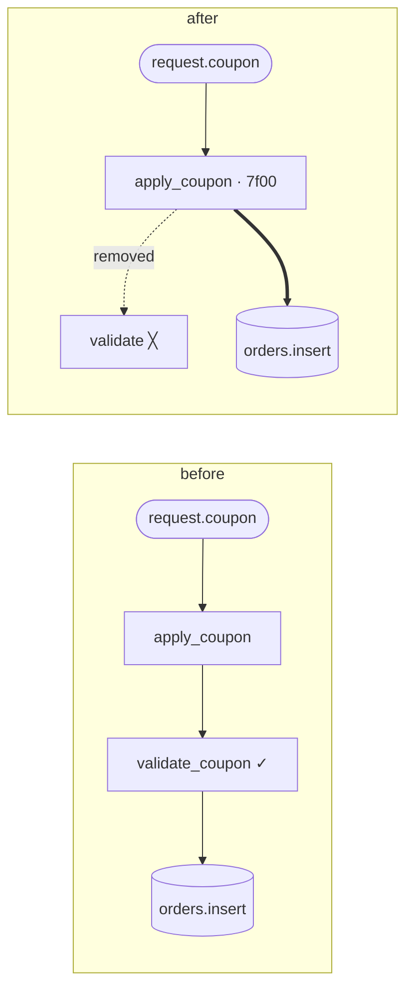
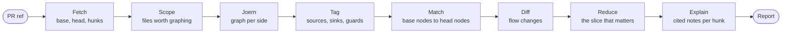

<p align="center">
  
</p>

<h1 align="center">witness</h1>

<p align="center">
  <b>Review a pull request by what it does to your data, not by what it does to your text.</b>
</p>

<p align="center">
  
  
  
  
</p>

---

A diff tells you which lines moved. Witness tells you what that means: which values now reach which sinks, which guards were added or bypassed, and which callers are new. It builds a code property graph of the base and the head with [Joern](https://joern.io), diffs the two graphs, maps every flow change back to the hunk that caused it, and explains each hunk in plain words. Every claim cites the evidence behind it.

## Use it

Install it ([below](#install)), then point it at a pull request.

```bash
witness analyze 482                       # a GitHub PR in the current repo
witness analyze https://bitbucket.org/acme/shop/pull-requests/482
witness analyze main..feature/discounts   # two revisions
witness analyze --base 3f2a1c9 --head 9b7e044 --format md > review.md
```

### Say what you want

In Claude Code, with the plugin installed:

| Situation | Say something like | What happens |
|---|---|---|
| **Review a PR** | "Review PR 482 with witness" | It starts an analysis in the background, shows the overview first (what to look at, description check, flow diagram), then pages through the hunk notes |
| **One hunk** | "Explain hunk 7f00e21b9c" | The note for that hunk, every sentence citing a finding id |
| **Show me the proof** | "What path makes you say the coupon isn't validated?" | The exact value path, step by step, with file and line on both sides |
| **Is this refactor safe?** | "Does this PR change any data flow?" | Hunks with no flow change are listed as such, so a pure refactor reads as one |
| **Does the description match?** | "Does the PR do what it says?" | Claims in the description that no change backs up, and changes the description leaves out |

### Or use a command

| Command | What it does |
|---|---|
| `/witness <pr>` | Analyse the PR: the overview first, then the hunk notes one page at a time |
| `/witness explain <hunk>` | Explain one hunk, citing its findings |
| `/witness paths <hunk>` | The value paths behind one hunk, with their exact lines |

Plain words work just as well; the commands are shortcuts.

---

## What you get

A report that starts with what deserves your eyes, then walks the hunks. This is a shortened excerpt; the full sample, with diagrams for every hunk, is in [docs/plans/2026-11-14-witness-example-output.md](docs/plans/2026-11-14-witness-example-output.md).

> **Look here first**
>
> | | Change | Path | Hunk |
> |---|---|---|---|
> | **!** | Guard bypassed | `request.coupon` → `db.orders.insert` no longer passes `validate_coupon()` | `7f00e21b9c` |
> | **~** | Rerouted | `cart.subtotal` → `payments.charge` now goes through `discount.apply()` | `c4d5e6f708` |
> | **+** | New caller | `checkout.total()` now calls `discount.apply()`, which affects its 4 callers | `c4d5e6f708` |
>
> **Description check**
>
> - ✗ **Described, not found:** "adds rate limiting to the coupon endpoint". No change in this PR does that.
> - ✗ **Found, not described:** coupon validation was removed (hunk `7f00e21b9c`).
>
> **`7f00e21b9c` · Coupon codes are no longer validated**
>
> `apply_coupon()` no longer calls `validate_coupon()` **[F4]**. Any coupon string from the request, including expired or made-up codes, is now stored on the order **[F5]** and discounted at checkout. The PR description doesn't mention this, so it may be accidental.

Before and after, as the report draws it:



### What it looks for

| Kind | Mark | Meaning |
|---|---|---|
| `guard_bypassed` | **!** | A source still reaches a sink, but no longer through a validator or sanitizer it used to pass |
| `guard_added` | ✓ | A path now passes a guard it skipped before |
| `added_flow` | **+** | A source reaches a sink it could not reach before |
| `removed_flow` | − | A source no longer reaches a sink |
| `rerouted` | **~** | The same source and sink, through different code |
| `new_caller` | **+** | A function gained a caller, so its behaviour now reaches more places |
| `lost_caller` | − | A function lost a caller |

Sources, sinks and guards come from per-language rule files in [src/witness/rules/](src/witness/rules/) (`common`, `python`, `javascript`, `java`, `go`, `c`). TypeScript uses the JavaScript rules.

---

## How it works



- **Fetch.** Resolves the PR to its merge-base and head SHA (`gh` for GitHub, the REST API for Bitbucket), checks each side out into a detached worktree under `.git/witness/`, and parses the hunks. Renames are followed.
- **Scope.** Picks the changed files plus the files that mention the names they change, so a large repo is not graphed whole.
- **Graph and tag.** Joern builds a code property graph for each side; the rule files tag sources, sinks and guards.
- **Match and diff.** Nodes in the base graph are matched to nodes in the head graph, then the two sets of flows are compared and each change is classified into one of the seven kinds above.
- **Hunk map.** Every flow change is pinned to the hunk that caused it. Hunks with no flow change are reported as such.
- **Reduce.** Each path is cut down to the nodes that matter (changed code, guards, sources, sinks, branch points); unchanged calls in between collapse to `… n calls …`.
- **Explain.** With an API key, Claude writes a short note per hunk from the facts alone. A validator rejects any note that cites a finding that does not exist or names an identifier the evidence does not contain. Without a key, or with `--no-llm`, the report carries the facts and paths without prose.

### Grounding

Witness is built so the explanation can't drift from the analysis:

- Every claim in a note cites a finding id (`F4`) or a path line.
- An identifier that isn't in the evidence is called unknown, not guessed.
- Files that could not be analysed are listed under coverage, and a partial run says so in its exit code.
- The prompt is versioned ([src/witness/prompts/explain.v1.md](src/witness/prompts/explain.v1.md)) and so is the report schema ([schema/witness.report.v1.json](schema/witness.report.v1.json)).

---

## Install

You need Python 3.12 or newer, git, and for deep analysis Java and Joern. `gh` (authenticated) is needed for GitHub PR refs; revision ranges work without it.

```bash
git clone https://github.com/iha2/witness.git
cd witness
uv sync                      # or: pip install -e .
uv sync --extra anthropic    # optional: prose explanations with Claude
```

Check the environment, and install Joern if it is missing:

```bash
witness doctor                    # git, java, joern, joern-parse, gh
witness doctor --install          # shows what it would download, downloads nothing
witness doctor --install --yes    # installs Joern to ~/.witness/joern
```

Add `~/.witness/joern` to your `PATH` afterwards. Without Joern, `witness analyze` still lists the hunks and exits with code 4.

### Claude Code plugin

The plugin lives in [plugin/](plugin/): the `/witness` command, the `witness` skill, and the MCP server. Load it for a session:

```bash
claude --plugin-dir ./plugin
```

The `witness` command must be on your `PATH` (activate the virtualenv, or install with `uv tool install .`).

---

## Reference

### `witness analyze`

| Option | Meaning |
|---|---|
| `<ref>` | A GitHub PR number or URL, a Bitbucket PR URL, or `base..head` |
| `--base <rev> --head <rev>` | Compare two revisions directly (the two go together) |
| `--repo <path>` | The repository to analyse (default: `.`) |
| `--no-llm` | Facts and paths only; no call to Claude |
| `--format text\|md\|json\|sarif\|annotations` | `text` for the terminal, `md` for a PR comment, `json` for tools (schema v1), `sarif` for code-scanning UIs, `annotations` for CI line annotations |

### Exit codes

| Code | Meaning |
|---|---|
| 0 | Analysis complete |
| 2 | Usage error |
| 3 | Environment error (a tool missing, a fetch failed) |
| 4 | Partial: Joern unavailable, hunks listed without flow analysis |

### Environment

| Variable | Used for |
|---|---|
| `ANTHROPIC_API_KEY` | Prose explanations (with the `anthropic` extra installed) |
| `WITNESS_MODEL` | The model for explanations (default `claude-sonnet-5-5`) |
| `WITNESS_JOERN_HEAP` | Joern's JVM heap (default `8g`) |
| `WITNESS_BITBUCKET_TOKEN` | Bitbucket PR access; sent only in the `Authorization` header |
| `GITHUB_TOKEN`, `GH_TOKEN` | Read by `gh` for GitHub PRs |

Tokens and URL credentials are redacted from every error message.

### MCP server

The server speaks stdio and keeps every response under about 8k tokens, so an agent pages through a review instead of swallowing the whole graph. Start it with `python -m witness.mcp_server`.

| Tool | What it returns |
|---|---|
| `analyze(repo, ref \| base, head)` | Starts an analysis in the background; returns a job id |
| `overview(job)` | Phase and progress, then the look-here-first summary once done |
| `list_hunks(page)` | One page of hunks with their change kinds |
| `hunk(id)` | One hunk's note and findings |
| `paths(id, page)` | The value paths behind a hunk, line by line |
| `graph(id, format)` | The hunk's before and after graph (Mermaid by default) |
| `submit_explanation(id, json_text)` | An agent-written note, checked by the citation validator before it is accepted |

---

## Evaluation

`witness eval` scores flow changes against a corpus and enforces release gates.

```bash
witness eval                         # eval/corpus.yaml
witness eval --corpus my.yaml --lang python
```

The corpus mixes mutations (a validator removed, a caller added, generated from [eval/mutations/](eval/mutations/)), pure refactors that must report nothing, and real PRs pinned to SHAs with hand-checked expectations.

| Gate | Threshold |
|---|---|
| Precision | ≥ 0.90 |
| Recall | ≥ 0.75 |
| False positives on pure refactors | ≤ 0.05 |
| Grounded explanations | ≥ 0.98 |

## Development

```bash
uv run pytest                 # the full suite
uv run pytest -m "not joern"  # skip tests that need a real Joern install
```

The design is in [docs/plans/2026-11-14-witness-architecture.md](docs/plans/2026-11-14-witness-architecture.md) and the build plan in [docs/plans/2026-11-14-witness-build.md](docs/plans/2026-11-14-witness-build.md).

## Status

Version 0.1.0. Joern is the only engine. GitHub and Bitbucket are the supported hosts; anything else works through revision ranges. Rules ship for Python, JavaScript and TypeScript, Java, Go and C.

## License

Apache-2.0
