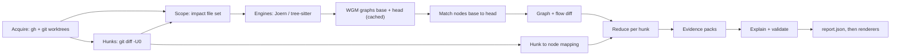

# Witness v1: technical architecture

Date: 2026-11-14 · Status: design for review (companion to `2026-11-14-witness-architecture.review.md`)
Evidence base: `2026-11-14-witness-dataflow-plugin.findings.md` (claim ids such as C2-15 cite the research ledger).

## 0. What we decided, and why

- Decided: the core is Python 3.12, managed with uv. git does all checkout, diff and rename work (`git worktree`, `git diff -U0 --find-renames`, `git cat-file`); we never re-implement diffing.
- Decided: Joern is the deep engine (Apache-2.0, 12 frontends, real inter-procedural data flow, C2-10, C1-7). tree-sitter is the any-language fallback for call graphs only (C1-12, C1-13).
- Decided: v1 has deep data flow for Java, C/C++, JS/TS, Python and C#. C# ships behind an eval quality gate because Joern gives it no maturity rating (C1-10). Every other tree-sitter language gets call-graph-only analysis and is labelled that way.
- Decided: new `witness` repo. v1 surfaces are the core CLI, a stdio MCP server, a Claude Code plugin and terminal output (rich text and tuicr/revdiff annotations). The GitHub Action and VS Code come in v2 on the same JSON contract (C6-16, C6-17).
- Decided: plan detail is `full`.
- Ruling: Witness diffs graphs in its own code, not inside an engine (because no engine offers a two-commit graph diff: C2-9, C1-5, C5-18).
- Ruling: explanations are grounded. Every sentence cites evidence ids, and a validator rejects anything it cannot ground (because about 50% of LLM review comments hallucinate (C8-1) and reviewers anchor on what the tool flags (C8-4)).
- Ruling: the evaluation harness is a v1 deliverable, not an afterthought (because the core value is unmeasured: C8-17).

What makes it best on the market: per the research, no tool diffs value flows between base and head (C5-18). Baz is the closest, and it is closed and works at module level (C5-4). Witness's moat is three things:
1. A precise flow diff, including "this value now bypasses X".
2. Explanations a machine can check against that diff.
3. Published accuracy numbers from its own eval.

## 1. Pipeline



Each stage is a pure function from typed inputs to typed outputs, written as frozen dataclasses with msgspec for (de)serialization. Each stage can be tested alone and caches by content hash.

## 2. Acquisition (`witness.acquire`)

- Input: a PR ref (`owner/repo#N`, a URL or a number in the current repo) or explicit `--base <rev> --head <rev>`.
- `gh pr view --json baseRefOid,headRefOid,mergeBaseOid?` resolves the SHAs. The base is the **merge-base** of base and head (`git merge-base`), so we diff exactly what the PR introduces.
- Checkouts: `git worktree add --detach <cache>/wt/<sha>` for each SHA. A worktree is reused when it is already present. Nothing is network-fetched except `git fetch origin <sha>` when a SHA is missing.
- Hunks: `git diff -U0 --find-renames=50% --find-copies <base> <head>` is parsed into `Hunk(id, old_path, new_path, old_range, new_range, kind)`. The hunk id is `sha1(new_path|old_start|new_start|text)[:10]`, which stays stable across reruns. The rename map comes from the same diff (`R087 a.py b.py`).
- Binary, generated and vendored files are dropped through `.gitattributes linguist-generated/vendored`, plus a configurable glob list.

## 3. Scoping (`witness.scope`)

Joern has no incremental mode and needs about 20 GB of heap at Linux scale (C1-22, C1-24), so we never build a whole-repo CPG by default.

1. The changed file set F comes from the hunks.
2. A cheap tree-sitter import/reference index over the whole repo is cached per tree SHA, using aider-style tags queries (C3-8).
3. Impact scope = F ∪ the files that import or reference symbols defined in F (up to `--scope-hops`, default 2) ∪ the files whose symbols F references (1 hop).
4. The scope is capped by `--scope-max-files` (default 400) and ranked by PageRank on the reference graph. Files that fall outside the cap are recorded as "unanalysed neighbours" so the report can be honest about coverage.
5. The same scope (a union over base and head) is used for both checkouts so the graphs are comparable.

`--scope full` builds the whole repo for small repos or in CI with memory to spare.

## 4. Engines (`witness.engines`)

```python
class GraphEngine(Protocol):
    name: str
    def supports(self, lang: Lang) -> Depth: ...          # NONE | CALLS | DATAFLOW
    def build(self, checkout: Path, files: list[Path], lang: Lang,
              budget: Budget) -> WGMGraph: ...             # pure; cached by (engine, version, sha, scope-hash)
```

- **JoernEngine**: the deep engine.
  - `joern-parse` runs on a temp dir that symlinks the scoped files and keeps their relative paths. Scala export scripts (shipped in the package) are then run through `joern --script` and emit WGM JSONL. They export methods, call sites with resolved callees, parameters, locals, fields, returns, and REACHING_DEF / ARGUMENT / RECEIVER / CALL edges.
  - The JVM heap comes from `--joern-heap` (default: min(8G, 50% of RAM)).
  - A long-lived `joern --server` mode is used by the MCP server to avoid JVM startup on reruns.
  - Runs with a timeout and no network access. Hitting a resource limit causes a graceful downgrade to CALLS depth for that language, and the report says so.
- **TreeSitterEngine**: any language with a grammar plus a tags query. It extracts definitions, call sites and imports. Callee resolution is by name and import-aware: same file, then the imported module, then a unique global name, otherwise `ambiguous`. Every CALLS edge gets a `confidence` (resolved / import / name / ambiguous). There are no DFLOW edges.
- **Optional SCIP resolution**: when a SCIP indexer for the language is on PATH, it upgrades tree-sitter callee resolution to exact symbols (C1-13). This is off by default and auto-detected.
- **Engine selection** per language: Joern when the language is in the v1 deep set and Joern is installed, otherwise tree-sitter. Base and head **always use the same engine and version**, or the diff is refused.

Joern install: `witness doctor` checks for JDK 21 and Joern, and `witness doctor --install` downloads a pinned Joern release into `~/.cache/witness/joern/<ver>` after asking. Nothing is installed without consent.

## 5. Witness Graph Model (WGM) (`witness.model`)

One language-neutral model, stored per (sha, engine, scope) in SQLite (WAL mode, one file per graph) with an in-memory `networkx`/`rustworkx` view for algorithms. rustworkx is the default for speed, with a pure-Python fallback.

```python
@dataclass(frozen=True)
class Node:
    id: int                      # local to one graph
    kind: NodeKind               # METHOD, PARAM, LOCAL, FIELD, CALL, RETURN, LITERAL, EXTERNAL, MODULE
    key: StableKey               # cross-version identity (below)
    span: Span | None            # path, start_line, end_line, start_col, end_col
    lang: Lang
    attrs: Mapping[str, str]     # name, type, signature, is_guard, is_sink, ...

@dataclass(frozen=True)
class StableKey:
    path: str                    # head-relative path after rename map
    qname: str                   # module.Class.method / ns::fn / Class#method
    sig: str                     # normalized param types or arity
    local: str = ""              # for PARAM/LOCAL/CALL: name + ordinal within method

class EdgeKind(Enum):
    CALLS = "calls"              # METHOD -> METHOD (via CALL)
    DFLOW = "dflow"              # value flow: def -> use (REACHING_DEF + arg/ret binding)
    ARG = "arg"; RET = "ret"; FIELD_W = "field_w"; FIELD_R = "field_r"; CONTAINS = "contains"
```

- **Sources and sinks**: a small rule pack in YAML per language family tags nodes as `source` (HTTP params, env, file and stdin reads, deserialization), `sink` (DB queries, exec, HTTP response, payments-style outbound calls, logging), `guard` (validators, sanitisers, auth checks, `if`-conditions dominating a call) and `external` (stdlib and third party). The packs can be extended per repo through `.witness/rules.yaml`. Guards are what make "now bypasses validation" detectable.
- **Library collapse**: every node outside the repo becomes one `EXTERNAL` node per package (C3-17 step 5).

## 6. Node matching base↔head (`witness.match`)

The matcher produces `Match = dict[base_id, (head_id, how, confidence)]`. It works in tiers and stops at the first that matches (C2-15):

1. **Exact stable key**, with the base path mapped through git's rename map.
2. **Signature drift**: same path and qname, but a different sig. This is a match, recorded as `changed_signature`.
3. **Body fingerprint**: a normalised tree-sitter AST hash of the method body, with identifiers and literals abstracted. This catches renames and moves across files.
4. **Structural fallback**: a GumTree-style top-down plus bottom-up match on the remaining unmatched methods, limited to pairs in the same or a renamed file. It is O(n²), but n is small after tiers 1–3 (C2-6, C2-8).
5. Sub-method nodes (PARAM, LOCAL, CALL) are matched within matched methods by (kind, name, ordinal), with ordinal re-alignment by LCS over call-site sequences.

Anything still unmatched is `added` (head) or `removed` (base). The matcher's precision and recall are measured directly in the eval (§12).

## 7. Graph and flow diff (`witness.diff`)

- **Edge diff**: under the match, each edge is classified `kept`, `added` or `removed`. A CALLS edge whose callee changed signature is `kept+changed`.
- **Flow diff**: the headline feature.
  - Inside the reduced region (§9), compute bounded source→sink and changed-node→sink value paths in base and in head: depth cap 7 (C3-6), path cap 200 per seed, k-shortest via Yen on DFLOW+ARG+RET.
  - Paths are compared by their **matched endpoint pair** (src, sink) and their guard set:
    - `added_flow`: the (src, sink) pair is reachable in head but not in base.
    - `removed_flow`: the reverse.
    - `rerouted`: reachable in both, but the minimal intermediate node set differs.
    - `guard_bypassed`: in base, **every** path from src to sink passes a guard g; in head **at least one** path avoids g. This is checked as a node-cut query on the head graph with g removed. It is the "value now skips validation" signal.
    - `guard_added`: the reverse.
    - `new_caller` / `lost_caller`: CALLS-edge deltas into changed methods (blast radius).
- Each finding is a `FlowChange(kind, src, sink, base_path?, head_path?, via_hunks, confidence)`. Confidence combines engine depth with matcher confidence. Tree-sitter-only languages produce only call findings and never claim value flow.

## 8. Hunk mapping (`witness.hunkmap`)

Hunk ranges are intersected with node spans using an interval tree per file (C2-14):
- Added and changed lines are matched against head spans.
- Removed lines are matched against base spans (through the rename map).
- A hunk outside any method, such as module-level code, config or imports, maps to the MODULE node.

The result is `HunkMap: hunk_id → {base_nodes, head_nodes, enclosing_methods}`. Each FlowChange is linked back to the hunks whose nodes lie on its path (`via_hunks`), so every hunk knows which flow changes it caused.

## 9. Reduction (`witness.reduce`)

This implements C3-17. It runs per hunk and once for the PR overview:
1. Seed with the hunk's mapped nodes.
2. Take the 1-hop CALLS neighbourhood (callers and callees), and go to 2 hops only when 1 hop has fewer than 5 nodes.
3. Run backward and forward DFLOW slices from the seeds, with a depth cap of 7.
4. Keep only flows that touch a changed edge or a changed node.
5. Collapse externals by package (already in WGM).
6. Roll nodes up by file or module when more than 50 remain.
7. Apply a render budget: a graph of 50 nodes or fewer, otherwise a ranked path list (CodeQL-style path steps, C4-3).
8. Rank by `guard_bypassed > added_flow(sink) > rerouted > new_caller > other`, with ties broken by PageRank.

The output is a `Slice(nodes, edges, paths, truncated: bool, dropped_counts)`. The truncation is always reported.

## 10. Evidence packs and grounded explanation (`witness.explain`)

**Evidence pack** for one hunk. It is compact (6k tokens or fewer) and deterministic:
```json
{"hunk": {"id":"a1b2c3d4e5","path":"orders/discount.py","new_range":[41,47],"text":"..."},
 "facts": [
  {"id":"F1","type":"enclosing","node":"orders.discount.apply","span":"orders/discount.py:30-60"},
  {"id":"F2","type":"caller","node":"checkout.total","span":"checkout.py:88"},
  {"id":"F3","type":"flow_change","kind":"rerouted","src":"cart.subtotal","sink":"payments.charge(amount)",
   "base_path":["F5","F6"],"head_path":["F5","F7"]},
  {"id":"F4","type":"guard_bypassed","guard":"validate_coupon","src":"request.coupon","sink":"db.orders.insert"}],
 "summaries": {"checkout.total": "Computes the order total charged to the customer."},
 "coverage": {"engine":"joern","depth":"DATAFLOW","unanalysed_neighbours":3}}
```

- **Bottom-up summaries**: one-line summaries of the enclosing method and its 1-hop neighbours, cached per (sha, method body hash). This follows HCGS (C3-10), limited to one level to stop hallucinations propagating.
- **Explainer contract**: the model returns JSON `{title, explanation: [{text, cites:[F..]}], impact: [...], questions: [...]}`, written in 2–3 sentences in application terms.
- **Validator** (deterministic, it runs after every generation):
  1. Every sentence has at least one cite, and every cite exists.
  2. Every code identifier in the text (backticked or matching `[A-Za-z_][\w.:#]*\(`) appears in the hunk text or in the facts.
  3. Every flow claim ("reaches", "bypasses", "now calls") is backed by a fact of the matching type.
  4. Numbers and literals appear in the hunk.

  On failure there is one repair round with the validator errors, then a fallback to a **templated** explanation rendered straight from the facts. The output is never ungrounded.
- **Where the LLM runs**:
  - Inside Claude Code, the host model writes the explanation: the MCP tool returns the pack plus the prompt, and `witness_submit_explanation` runs the validator.
  - In the CLI, an optional Anthropic API call (default `claude-sonnet-5-5`, configurable).
  - `--no-llm` produces templated explanations only.

  The prompts live in one versioned prompt library shared by every host (C6-16).
- **Overview**: the top 5 flow changes for the whole PR, a grouped list of hunks by enclosing module, and a short Mermaid flow overlay when flows changed (C7-21).

## 11. Outputs, renderers and hosts

- **Canonical contract**: `witness.report.json` (JSON Schema, versioned `witness/v1`). It holds `meta`, `coverage`, `hunks[]` (id, location, title, explanation with cites, flow_changes, slice ref), `flow_changes[]`, `slices/` (one file per hunk) and `overview`. Every renderer and host reads only this file.
- **Renderers**:
  - `text`: rich/ANSI. The terminal default (C4-18) is a numbered changed-path list with +/− markers.
  - `markdown`: an overview plus per-hunk sections.
  - `mermaid`: an overlay with added edges green, removed red dashed, unchanged grey, and 50 nodes or fewer (C4-17).
  - `annotations`: hunk-keyed JSONL for tuicr ReviewStore and revdiff (C7-14, C7-15).
  - `sarif`: codeFlows for flow changes, so v2 GitHub code scanning is free (C4-3).
- **CLI**: `witness analyze <pr|--base --head> [--format ...] [--out dir]`, `witness explain <hunk-id>`, `witness paths <hunk-id>`, `witness show` (pager), `witness doctor`, `witness eval`.
- **MCP server** (stdio, Python `mcp` SDK): the tools are `analyze`, `overview`, `list_hunks(page)`, `hunk(id)`, `paths(id, page)`, `graph(id, format)` and `submit_explanation(id, json)`. Every response stays under 8k tokens with cursor paging. Large graphs are written to files and returned as paths (C6-4, C7-16). `analyze` runs in the background and returns a job id, because calls longer than 2 minutes go to the background anyway (C6-4).
- **Claude Code plugin**: `.mcp.json`, a `witness` skill (how to review a PR with Witness, and the grounding rules), and the commands `/witness <pr>`, `/witness explain <hunk>` and `/witness paths <hunk>`. There is optional Mermaid in an Artifact for graphs, and `userConfig` holds the API key and Joern path (C6-3).

## 12. Evaluation harness (`witness.eval`), the quality bar

- **Corpus**: about 60 PRs (10 per deep language plus 10 for tree-sitter-only languages), drawn from small pinned OSS repos plus **synthetic mutation PRs**, which give exact ground truth:
  - removing a validator call (expect `guard_bypassed`)
  - inserting a new caller (`new_caller`)
  - rerouting a value through a new helper (`rerouted`)
  - renaming or moving a function (the matcher must match it with no false flow change)
  - pure refactors (expect zero flow changes)
- **Metrics**, per language:
  - flow-change precision and recall
  - matcher precision and recall
  - hunk→node mapping accuracy
  - explanation **groundedness** (validator pass rate plus an LLM-judge sample against the facts)
  - **hallucination rate** (claims not in the facts)
  - refactor false-positive rate
  - p50 and p95 runtime, and peak RSS
- **Release gates**:
  - Any deep language: flow precision ≥ 0.90, recall ≥ 0.75, refactor false-positive rate ≤ 5%, groundedness ≥ 0.98.
  - C# is enabled by default only once it passes the same gates; otherwise it ships as `experimental`.
- `witness eval --lang X --report` writes a markdown scorecard that the README publishes.

## 13. Performance and resource budgets

| Case | Target |
|---|---|
| tree-sitter only, PR touching 20 files in a 200k-LOC repo | p50 under 15 s |
| Joern, same PR, cold (both graphs) | p50 under 4 min, peak RSS under 8 GB |
| Joern, warm base cache (new head commit) | p50 under 90 s |
| MCP `hunk(id)` after analysis | under 300 ms |
| Explanation per hunk (LLM) | parallel, max 8 concurrent, cached by (pack hash, prompt version) |

The caches, all content-addressed under `~/.cache/witness/`, are:
- tree-sitter index per tree SHA
- WGM per (sha, engine, version, scope hash)
- summaries per body hash
- explanations per pack hash

A base graph is reused across every PR that shares the merge-base.

## 14. Failure handling

- **Engine crash, OOM or timeout**: downgrade that language to CALLS depth, set `coverage.degraded[]`, and keep going.
- **Engine version mismatch between base and head**: refuse and suggest `witness cache clear`.
- **Unparseable file**: skip it, record it in coverage, and keep going.
- **No `gh` or no auth**: explicit `--base/--head` still works.
- **LLM unavailable**: templated explanations, with the report marked `explanations: templated`.
- The exit codes are:

  | Code | Meaning |
  |---|---|
  | 0 | ok |
  | 2 | usage |
  | 3 | environment, from doctor |
  | 4 | partial: some languages degraded |

## 15. Testing strategy

- Unit tests per stage use small hand-built WGM fixtures. Hypothesis property tests cover the matcher (an identity diff yields zero changes, a pure rename yields zero flow changes) and the diff symmetry (base↔head swap turns added into removed).
- Golden tests run on tiny multi-language fixture repos built as git repos in tmp, with a base commit and a head commit. They snapshot `report.json` with ids normalised.
- Joern integration tests are marked `@pytest.mark.joern`, and are skipped with a reason when Joern or the JDK is missing. Contract tests run against the exported WGM JSONL schema.
- MCP tests check tool schemas, the paging invariant (every response stays under the token cap) and the job lifecycle.
- The validator gets adversarial tests: invented identifiers, missing cites, wrong flow types.
- The eval harness itself has a smoke run of 3 PRs in CI.

## 15b. Developer-experience mechanics

- **Fast-then-deep streaming**:
  - `analyze` emits NDJSON events (`hunks`, `calls_ready`, `deep_ready`, `explained`).
  - The text renderer redraws in place.
  - MCP `analyze` returns a job id, and `overview` reports `phase: calls|deep|done`.
- **Determinism**:
  - Hunk, fact and finding ids are content hashes.
  - The sort key is (severity rank, path, line).
  - Grouping is by module path.
  - LLM text is cached per (pack hash, prompt version, model), so a rerun gives byte-identical output.
- **Quiet by default**:
  - Findings below `confidence < 0.6`, or that are call-graph-only, are folded into a "+N more (`--all`)" line.
  - When a PR has zero flow changes, Witness prints "no behaviour change found" with its coverage.
- **Review memory**:
  - `~/.cache/witness/reviews/<repo>/<pr>.json` stores the finding ids seen and the resolved and `??` marks, keyed by head SHA.
  - On a new head, findings are split into new, changed (same endpoints, different path) and resolved.
  - `??` marks are exported to `eval/feedback.jsonl`.
- **Description check**:
  - An LLM extracts behaviour claims from the PR title and body into a JSON list.
  - Each claim is matched to flow changes and hunks by identifier and module overlap, giving `described_not_found` and `found_not_described`.
  - The usual validator applies, and claims that cannot be matched are reported, never guessed.
  - The research basis is C8-3.
- **Zero-argument mode**: with no PR given, head is `HEAD` (including the uncommitted worktree, through `git stash create`) and base is `git merge-base HEAD @{upstream}`, falling back to the default branch.

## 16. Repo layout (new `witness` repo)

```
witness/
  pyproject.toml            # uv, python 3.12, entry point `witness`
  src/witness/{acquire,scope,engines/{joern,treesitter,scip},model,match,diff,hunkmap,reduce,explain,render,mcp,eval,cli}.py|/
  src/witness/engines/joern/scripts/*.sc     # Scala export scripts
  src/witness/rules/*.yaml                   # source/sink/guard packs
  src/witness/prompts/*.md                   # versioned prompt library
  schema/witness.report.v1.json
  plugin/ (.claude-plugin/plugin.json, .mcp.json, skills/witness/SKILL.md, commands/)
  eval/{corpus.yaml,mutations/,fixtures/}
  tests/
```

Dependencies (all OSS-licensed and shippable): `tree-sitter` + `tree-sitter-language-pack`, `rustworkx`, `msgspec`, `rich`, `mcp`, `intervaltree`, `pyyaml`, `anthropic` (optional extra), `hypothesis` and `pytest` (dev). Joern is an external, user-installed dependency (Apache-2.0).
