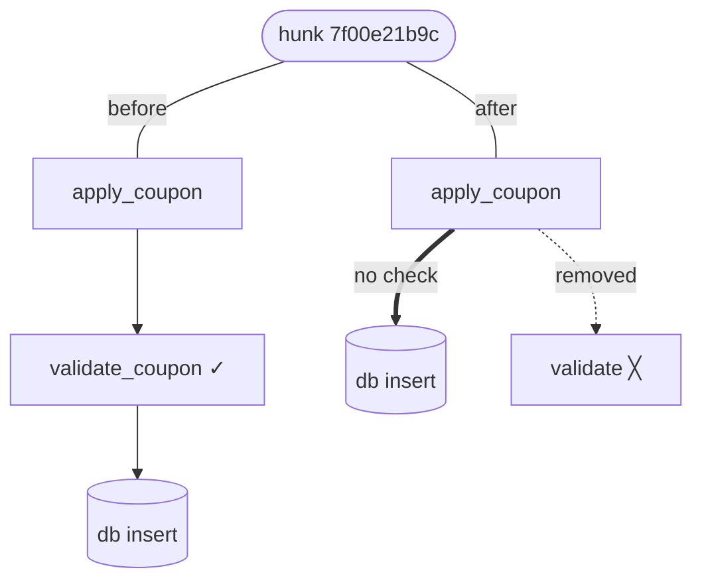
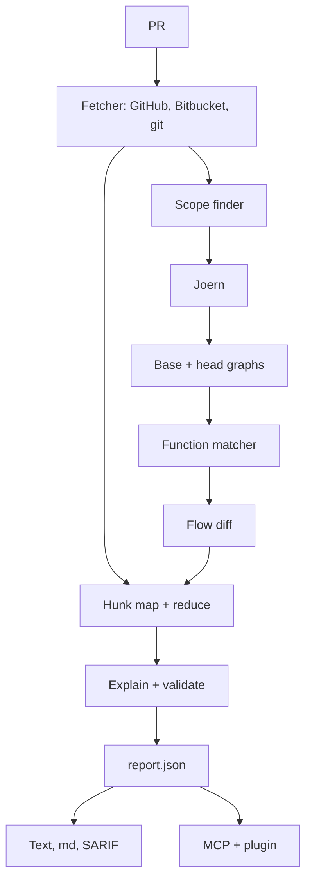
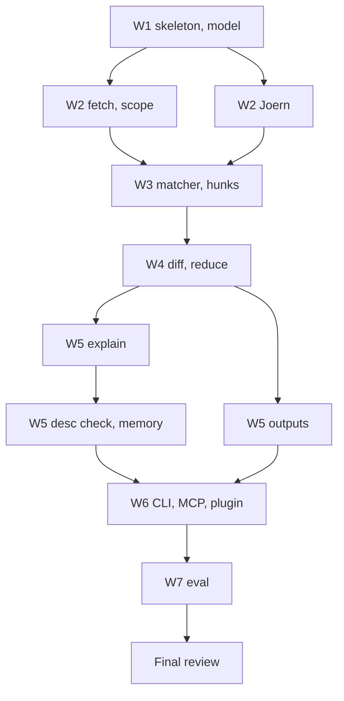

# Witness v1: review plan

Full technical design: `docs/plans/2026-11-14-witness-architecture.md`.
Evidence: `docs/plans/2026-11-14-witness-dataflow-plugin.findings.md`.

## Summary

Witness takes a pull request from GitHub or Bitbucket and does six things:
1. Builds a call graph and a value-flow graph for the code before the change (base) and after it (head).
2. Lines the two graphs up function by function.
3. Reports what really changed in behaviour: new callers, lost callers, values that now reach a different place, and, most importantly, values that now **skip a check** they used to go through.
4. Explains each changed section of the diff (each git hunk) in two or three sentences, in terms of what the application does.
5. Ties every sentence to a fact from the graph.
6. Rejects any sentence it cannot back with a fact.

The research found no tool that diffs value flow between two versions (C5-18). Witness is built around three things that together make it the best tool up front:
- that flow diff
- explanations a machine can check
- an accuracy scorecard it publishes for itself

The core is Python. git does all checkout and diff work. Joern is the one analysis engine: it builds both the call graph and the value-flow graph, for every language it supports.

## What you will get

- A `witness` command:
  - `witness analyze <PR>` prints a numbered list of changed flows, then a short note per hunk.
  - `witness explain <hunk>` and `witness paths <hunk>` drill into one hunk.
- Deep value-flow analysis for Java, C/C++, JavaScript/TypeScript and Python. C# is included too, marked experimental until it passes the quality bar.
- Call-graph and value-flow analysis, marked experimental until each passes the quality bar, for the other languages Joern reads: Go, Kotlin, PHP, Ruby and Swift.
- A Claude Code plugin with three commands:
  - `/witness <PR>` reviews a whole PR in chat.
  - `/witness explain <hunk>` explains one hunk.
  - `/witness paths <hunk>` shows the value paths behind one hunk.

  Behind them is an MCP server that pages its answers, so large PRs never flood the chat.
- Several output forms:
  - JSON as the one contract every surface reads
  - markdown
  - coloured terminal text
  - a Mermaid before/after picture
  - per-hunk annotations that terminal diff reviewers (tuicr, revdiff) can show inline
  - SARIF, so GitHub code scanning works later at no extra cost
- `witness doctor`, which checks for Java 21 and Joern and offers to install Joern only after you say yes.
- `witness eval`, which runs about 60 test PRs with known answers and prints a scorecard per language.

## What it will look like

These are mockups for an example PR that changes a discount rule and moves coupon checking. They show the target, not finished output.

**Terminal: `witness analyze 482`**, the default view, a numbered list of changed flows and then one note per hunk:

```text
witness · acme/shop#482 "Simplify discount rules"   base 3f2a1c9 → head 9b7e044
engine: joern (python, java, go) · 214 files in scope · 41s

FLOW CHANGES (3)
 1 ! guard bypassed   request.coupon ──▶ db.orders.insert        skips validate_coupon()
     base: request.coupon → apply_coupon → validate_coupon → db.orders.insert
     head: request.coupon → apply_coupon ──────────────────▶ db.orders.insert
 2 ~ rerouted         cart.subtotal ──▶ payments.charge(amount)  now via discount.apply()
 3 + new caller       checkout.total() now calls discount.apply()   (blast radius: 4 callers)

HUNKS (5)                                                         [cites]
 a1b2c3d4e5  orders/discount.py:41-47   Orders of exactly $100 now get the discount
             The threshold changed from > 100 to >= 100, so a $100 cart now gets
             10% off, and that lower total is what payments.charge() receives.   F1 F3
 7f00e21b9c  orders/coupon.py:12-19     Coupon codes are no longer validated   ! 1
             apply_coupon() stopped calling validate_coupon(), so any coupon
             string from the request is written straight to the orders table.   F4
 ...
coverage: 3 neighbour files not analysed (scope cap) · explanations: claude-sonnet-5-5, 5/5 grounded
next: witness explain 7f00e21b9c · witness paths 7f00e21b9c · witness show (pager)
```

**Terminal: `witness paths 7f00e21b9c`**, the value path step by step, with each step linked to its line of code:

```text
guard bypassed: request.coupon → db.orders.insert          confidence: high (joern, dataflow)
  BASE                                       HEAD
  1 api/orders.py:22   coupon = req.json["coupon"]   1 api/orders.py:22   (same)
  2 orders/coupon.py:12 apply_coupon(coupon)         2 orders/coupon.py:12 apply_coupon(coupon)
  3 orders/coupon.py:15 validate_coupon(coupon)  ✗   -  (removed in hunk 7f00e21b9c)
  4 orders/repo.py:58  db.orders.insert(..coupon)    3 orders/repo.py:58  db.orders.insert(..coupon)
```

**Claude Code: `/witness 482`**: the overview arrives first, then hunk notes one page at a time, and you can ask about any hunk:

```text
> /witness 482
Witness found 3 flow changes in #482. The one to check first:
  ! Coupon codes now reach the orders table without validate_coupon()  (hunk 7f00e21b9c)
Hunks 1–5 of 5 below. Say "explain 7f00e21b9c" or "show paths for 2" to dig in.
  ● orders/discount.py:41  Orders of exactly $100 now get the discount   [F1 F3]
  ● orders/coupon.py:12    Coupon codes are no longer validated   ! [F4]
  ...
> why does hunk 2 matter?
  Before this PR every coupon went through validate_coupon() before the insert
  (orders/coupon.py:15). Now apply_coupon() passes it straight on [F4], so an
  expired or forged code is stored and discounted at checkout.total() [F2].
```

**Picture layout rules**, on every surface:

1. **The picture goes directly under the code it represents.** Each hunk shows its code first, then its before | after picture, then the explanation. That holds for the terminal cards, the Claude Code replies, tuicr notes, markdown and GitHub.
2. **Before and after are always side by side**, with before on the left. They never stack, so the reader compares them across the same rows and the picture uses its space well.

Hunks with no flow change get no picture.

**Per-hunk picture in Mermaid** (markdown, GitHub, Artifacts), under the hunk's code. A shared hunk node at the top keeps both sides in one diagram, so every renderer, innomd included, draws them as two columns. A dashed edge was removed and a bold edge is new:

```diff
 def apply_coupon(order, code):
-    coupon = validate_coupon(code)
-    if coupon is None:
-        raise InvalidCoupon(code)
-    order.coupon = coupon
+    order.coupon = Coupon(code)
     db.orders.insert(order)
```



**In a terminal diff reviewer (tuicr / revdiff)**, the note goes directly under the hunk's last changed line:

```text
orders/coupon.py
  12   def apply_coupon(order, code):
  13 -     coupon = validate_coupon(code)
  14 -     if coupon is None:
  15 -         raise InvalidCoupon(code)
  16 -     order.coupon = coupon
  13 +     order.coupon = Coupon(code)
  14       db.orders.insert(order)
  ┃ witness ! Coupon codes are no longer validated                 F4 F5
  ┃   before                            after
  ┃   apply_coupon                      apply_coupon
  ┃     └▶ validate_coupon ✓              ╳ validate_coupon
  ┃          └▶ db.orders.insert          └▶ db.orders.insert
```

The full mockup for every surface is in `docs/plans/2026-11-14-witness-example-output.md`.

## Developer experience: what the research implies

The research points at nine rules for how Witness should behave:

1. **Point at the risk; don't hand down a verdict.** Reviewers who start from an AI review look where the AI points. They find more small issues but no more serious ones, and save no time (C8-4).
   - Witness opens with the few flow changes that matter most, such as a bypassed check, a new sink, or a reroute into payments.
   - Each one is framed as "look here, and here is why".
   - Witness never says "approve" or "looks good", and it always shows what it did *not* analyse, so silence is never read as safety.
2. **Every claim can be checked in one step.** About half of AI review comments contain hallucinations (C8-1).
   - Every sentence carries fact ids.
   - `witness paths <hunk>` shows the exact lines behind a claim.
   - Ungrounded text never ships.
3. **Short first, depth on demand.** An earlier run found that full traces gave reviewers no gain, and the rendered graph is capped at about 50 nodes (C3-17).
   - Each hunk gets a title plus 2–3 sentences.
   - Paths, graphs and the full slice are each one command away, never printed by default.
4. **Quiet by default; false alarms are the enemy.** Developers want upfront reviews for big or unfamiliar PRs but distrust false positives (C7-12, C8-14).
   - Low-confidence and experimental-language findings are folded into a "more" line.
   - A pure refactor prints "no behaviour change found", with its coverage.
   - The refactor false-alarm rate is a release gate.
5. **Something useful while Joern works.**
   - The hunk list and diff, which come from git alone, appear within seconds.
   - Caller, callee and value-flow findings stream in as soon as Joern finishes.
   - The MCP server does the same through a background job, so Claude Code is never blocked (C6-4).
6. **Text first, everywhere.** Claude Code shows images as `[Image]` and tmux drops image protocols (C4-11).
   - The primary view is the numbered path list (C4-18).
   - Mermaid and Artifacts are extras.
   - Output is paged so it never hits the MCP cap (C7-16).
7. **Same input, same output.** CodeRabbit's grouping is generated by an LLM and changes between runs (C7-8). Witness's ids, ordering and grouping are deterministic and come from the graph. Only the wording comes from the model, and it is cached.
8. **Review again only what changed.**
   - On a new push, `witness analyze` shows "since your last review": new, changed and resolved flow changes.
   - Resolved notes stay resolved (C7-21).
   - A `??` reply on a note marks it as wrong, and those marks feed the eval (C7-22).
9. **Zero setup to first result.**
   - Run inside a repo with no arguments, and Witness compares your branch with the merge-base of its upstream.
   - Pass a PR number or URL to pull the PR from GitHub (through gh) or Bitbucket (through its REST API). Witness picks the host from the repo's remote.
   - Without Java, Witness shows the hunk list and says how to enable analysis (`witness doctor`).

One feature follows directly from C8-3. PRs whose descriptions claim changes that were never made merge far less often (28% vs 80%) and take 3.5 times longer. Witness can compare the PR description with the flow diff and flag "described but not found" and "found but not described". That makes it a **description check** that no reviewer tool offers.

## What will be built

| Part | What it does (one sentence) | Size | Built by |
|---|---|---|---|
| Project skeleton | Sets up the new repo with the command, tests, cache folder and settings | S | a fast helper |
| PR fetcher | One host-neutral interface for a PR (base, head, title, description), the GitHub side through gh, and git to check both commits out side by side and list the hunks and renames | M | a careful helper |
| Bitbucket connector | Reads a Bitbucket Cloud PR (base and head commits, title, description) through the REST API with an API token, and fetches both commits with git. The token goes to git only through environment variables, never in a URL, a log or `.git/config` | M | a careful helper |
| Scope finder | Uses git alone: `git diff` for the changed files and functions (git's built-in function-name patterns per language), then `git grep` for files that name those functions or modules. Joern never has to load the whole repo, and no extra parser is needed | M | a careful helper |
| Shared graph model | One language-neutral shape for functions, values, calls and flows, saved per commit | M | a careful helper |
| Joern engine | Runs Joern on the scoped files and converts its call graph and value-flow graph into the shared model | L | a careful helper |
| Check and sink rules | Marks validators, auth checks, inputs and outputs (DB, payments, HTTP) per language, and lets each repo extend them | M | a careful helper |
| Function matcher | Pairs base and head functions even when renamed, moved or re-signed | L | a careful helper |
| Flow diff | Finds added, removed and rerouted flows, bypassed checks, and new or lost callers | L | a careful helper |
| Hunk mapper and reducer | Links each hunk to its graph nodes and trims the graph to the 50 or so nodes worth reading | M | a careful helper |
| Explainer and validator | Builds a fact sheet per hunk, has the model explain it with citations, and rejects or replaces anything ungrounded | L | a careful helper |
| Description check | Compares the PR description with the flow diff and flags claims with no matching change, and changes the description never mentions | M | a careful helper |
| Review memory | Remembers what you already saw, shows only what is new since your last review, and records `??` marks | M | a careful helper |
| Outputs | JSON contract plus terminal, markdown, Mermaid, annotation and SARIF views, quiet by default and deterministic | M | a careful helper |
| Command line and doctor | The `witness` commands with zero-argument mode, streaming of findings as Joern finishes, the health check, and clear error codes | M | a careful helper |
| MCP server | Exposes analysis to Claude Code and other hosts, with paging and background jobs | M | a careful helper |
| Claude Code plugin | The plugin manifest, the review skill, and the `/witness` commands | S | a fast helper |
| Evaluation harness | Test PRs with known answers (removed check, new caller, rename, pure refactor) and the scorecard with release gates | L | a careful helper |

## How it fits together



## Key code changes

The headline signal is a bypassed check. In base, every path from an input to a sink went through a validator. In head, at least one path goes around it:

```python
def guard_bypassed(base: Graph, head: Graph, m: Match, src, sink, guard) -> bool:
    every_base_path_guarded = not has_path(base.without(guard), src, sink)
    g_head = m.to_head(guard)
    head_path_avoids = has_path(head.without(g_head) if g_head else head,
                                m.to_head(src), m.to_head(sink))
    return every_base_path_guarded and head_path_avoids
```

Functions are matched across versions in tiers, stopping at the first that fits, so renames and moves do not show up as fake flow changes:

```python
TIERS = (exact_key,          # same path (after git renames), name, signature
         signature_drift,    # same name, parameters changed
         body_fingerprint,   # same normalised body: rename or move
         structural_match)   # GumTree-style tree match on what is left
```

Every explanation sentence must cite facts. The validator either accepts it, asks for one repair, or falls back to a plain template built from the facts:

```python
def validate(expl: Explanation, pack: EvidencePack) -> list[Problem]:
    probs = [Problem("no-cite", s) for s in expl.sentences if not s.cites]
    probs += [Problem("bad-cite", c) for s in expl.sentences for c in s.cites if c not in pack.facts]
    probs += [Problem("unknown-identifier", i) for i in identifiers(expl) if i not in pack.vocabulary]
    probs += [Problem("unbacked-flow-claim", s) for s in expl.sentences if claims_flow(s) and not flow_fact(s, pack)]
    return probs
```

## How it gets built



## Decisions you can change

- Repo location: a new git repo at `~/Work/witness` (default) | another path
- Core language: Python 3.12 with uv (decided) | —
- Languages: Java, C/C++, JS/TS and Python at full quality; C#, Go, Kotlin, PHP, Ruby and Swift marked experimental until they pass the eval gates (decided)
- Engine: Joern only, for both the call graph and value flow (decided). No second engine and no tree-sitter tier.
- PR hosts: GitHub and Bitbucket Cloud in v1 (decided) | add Bitbucket Data Center (self-hosted) too
- Scope: found with git only (`git diff` plus `git grep` for the changed names) (decided). It may pull in a few extra files where a name is common. That costs Joern time but never hides a change.
- Graph library: rustworkx with a pure-Python fallback (default) | networkx only
- Model for CLI explanations: Claude Sonnet 5.5 through the API (default) | Opus 5.5 | none, templates only. Inside Claude Code the host model writes them.
- Scope size: changed files plus 2 hops of name matches, capped at 400 files (default) | the whole repo
- Joern install: offered by `witness doctor` after a yes (default) | you install it yourself
- Release gate for each deep language: flow precision ≥ 0.90, recall ≥ 0.75, refactor false alarms ≤ 5%, grounded sentences ≥ 98% (default) | your numbers
- Description check: in v1 (default) | v2
- Review memory ("since your last review"): in v1 (default) | v2
- Whole test suite at finish: no, affected tests only (default) | yes, once at finish

## Risks

- **Joern memory and speed on big repos** (C1-22). We only feed it the scoped files, cache base graphs, and report a timeout as a coverage gap rather than a silent miss.
- **Joern's C# quality is unrated** (C1-10). C# stays experimental until it passes the eval gates.
- **Fake flow changes from renames and refactors.** The tiered matcher handles them, and the eval tracks the refactor false-alarm rate as a release gate.
- **LLM hallucination** (C8-1). The validator, the cite-or-reject rule and the template fallback mean no ungrounded sentence ships.
- **Reviewers over-trusting the tool** (C8-4). Coverage and "unanalysed neighbours" are always shown, and confidence is shown per finding.
- **Joern's export format changes with its daily releases.** We pin a Joern version and run contract tests on the export.
- **Large outputs flooding chat** (C6-4). The MCP server pages answers and writes big graphs to files.

## Out of scope

- The GitHub Action with PR comments, the gh extension, and VS Code. These are v2, built on the same JSON.
- Running the base and head apps, and runtime probes.
- An interactive web graph view or MCP Apps UI.
- Incremental Joern graphs. We rebuild the scope and cache by commit instead.
- Languages Joern cannot read. Witness lists their hunks and reports them as not analysed.

## How we will know it works

- On a fixture PR that removes a validator call before a database insert, `witness analyze` lists a **bypassed check** naming the validator, the input and the sink, and the hunk note cites it.
- On a pure rename or move PR, Witness reports zero flow changes.
- On a PR in a language Joern cannot read, Witness lists the hunks and reports them as not analysed in Coverage.
- `/witness <PR>` in Claude Code shows an overview, then pages per-hunk notes without hitting the output cap.
- Planting a made-up function name in an explanation makes the validator reject it.
- `witness eval` prints a per-language scorecard, and the deep languages meet the release gates (C# reports pass or experimental).
- `witness doctor` reports a missing Java or Joern clearly, and installs nothing without a yes.
- Running `witness` with no arguments on a branch prints the hunk list in under 15 seconds, then adds Joern's findings when they are ready.
- Running the same analysis twice gives the same ids, order and grouping.
- `witness analyze <bitbucket PR URL>` produces the same report as for the same change on GitHub, and the token never appears in output, logs or `.git/config`.
- On a PR whose description says "adds rate limiting" when no such change exists, the description check flags the claim as described but not found.
- After a new push, `witness analyze` shows only new, changed and resolved findings since your last review.

## Rough time and cost

18 parts: 2 S, 11 M and 5 L. That comes to roughly 3.5 to 6 hours of build time and about $75 to $170 in model cost. These numbers are rough until the machine plan is linted.
