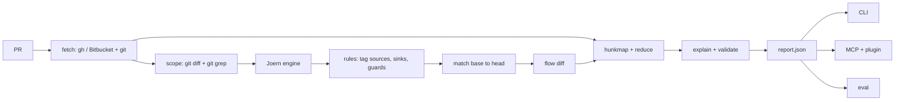
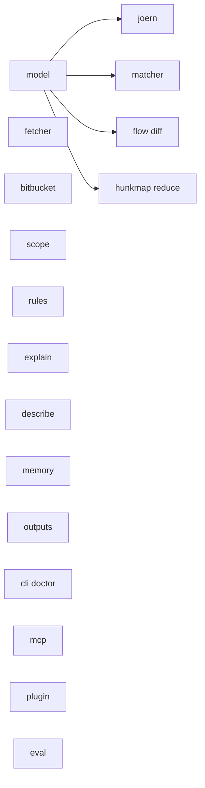

# Witness v1 build plan

**Review plan:** docs/plans/2026-11-14-witness-architecture.review.md
**Goal:** `witness analyze <PR>` diffs Joern call and value-flow graphs between base and head and explains each hunk, grounded in evidence.
**Architecture:** pure stages over one graph model (WGM): fetch → scope → Joern → tag → match → diff → hunkmap/reduce → explain → report.json → renderers, CLI, MCP, plugin.
**Tech stack:** Python 3.12, uv, pytest, hypothesis, msgspec, rustworkx, rich, mcp, intervaltree, pyyaml, anthropic (extra).
**Spec:** docs/plans/2026-11-14-witness-architecture.review.md (design detail: docs/plans/2026-11-14-witness-architecture.md §2–§15b; sample output: docs/plans/2026-11-14-witness-example-output.md)
**Detail:** contracts
**Full suite:** no
**Target-min:** 14

Global constraints:
- Package `witness` under `src/witness/`, tests under `tests/`, run with `uv run pytest -q`. Entry point `witness = "witness.cli:main"`.
- Shared types live in `src/witness/types.py` (Wave 0, frozen dataclasses): `Hunk(id, old_path, new_path, old_start, old_len, new_start, new_len, text)`, `PRInfo(host, base_sha, head_sha, title, body)`, `Scope(files: list[str], unanalysed: list[str])`, `FlowChange(kind, src, sink, guard, base_path, head_path, via_hunks, confidence)`, `Match = dict[int, tuple[int, str, float]]`. Errors: `WitnessError`, `EnvError(WitnessError)`, `UsageError(WitnessError)`.
- Hunk id = `sha1(f"{new_path}|{old_start}|{new_start}|{text}")[:10]`.
- FlowChange kinds: `guard_bypassed, guard_added, added_flow, removed_flow, rerouted, new_caller, lost_caller`. Rank order is that list.
- Credentials (GitHub, Bitbucket, Anthropic) never appear in argv, URLs, logs, reports or `.git/config`; git gets them only via `GIT_CONFIG_COUNT/KEY_n/VALUE_n` env.
- Joern is the only engine. Base and head must use the same Joern version, else `EnvError`.
- Exit codes: 0 ok, 2 usage, 3 environment, 4 partial.
- Every explanation sentence cites fact ids; uncited output is never emitted (templated fallback).
- Ruling: detail `contracts`, not `full` - the 15k plan cap cannot hold full code for 18 parts; algorithms are in the design doc §6–§10 - cost: more NEEDS_CONTEXT replies.
- Ruling: the review plan's "Project skeleton" is Wave 0 (generated by `wave0`), so 17 numbered tasks plus T0 - cost: none.
- Ruling: the design doc still names tree-sitter; the approved review plan wins (Joern only, git scope, Bitbucket) - cost: implementers must ignore design-doc tree-sitter parts.

## File structure

- `types.py` shared types · `model.py` Graph + SQLite store · `acquire.py` hosts, checkout, hunks · `bitbucket.py` Bitbucket Cloud host
- `scope.py` git scope · `engines/joern.py` + `engines/joern/export.sc` · `rules.py` + `rules/*.yaml`
- `match.py` · `diff.py` · `hunkmap.py` · `reduce.py` · `explain.py` + `prompts/explain.v1.md` · `describe.py` · `memory.py`
- `render.py` + `schema/witness.report.v1.json` · `pipeline.py` · `cli.py` · `doctor.py` · `mcp_server.py` · `plugin/` · `eval/` (`witness/eval.py`, `eval/corpus.yaml`, `eval/mutations/`)

## Engine and model

App type: library. Categories: deep, state, encoding.
**Probe entry:** call=witness.model.Graph.has_path

### T2 Graph model · Complexity 5 · Est. context 30k
**Owns:** src/witness/model.py, tests/test_model.py
**Components:** 2
**LOC owned:** 200
**Tests:** fast
**Kind:** design
**Model:** sonnet
**Consumes:** none
**Produces:** model.Graph.add_node(kind: str, key: tuple[str, str, str, str], span: tuple[str, int, int] | None, attrs: dict[str, str]) -> int · model.Graph.add_edge(src: int, dst: int, kind: str) -> None · model.Graph.has_path(src: int, dst: int, kinds: set[str], without: set[int]) -> bool · model.save_graph(g: Graph, path: Path) -> None · model.load_graph(path: Path) -> Graph
e.g. g.add_node("METHOD", ("a.py","a.f","1",""), ("a.py",1,4), {}) -> 0
e.g. after edges 0→1, 1→2 dflow: g.has_path(0, 2, {"dflow"}, set()) -> True; g.has_path(0, 2, {"dflow"}, {1}) -> False
**Review Focus:** `test_roundtrip_sqlite`: save then load gives equal nodes and edges; `test_cycle_has_path`: 0→1→0 terminates, has_path(0,1) True; `test_unknown_node_raises`: add_edge(0, 99) raises KeyError
**Test code:** named tests above plus `test_by_key_lookup`: g.by_key(("a.py","a.f","1","")) -> 0.

### T6 Joern engine · Complexity 7 · Est. context 45k
**Owns:** src/witness/engines/joern.py, src/witness/engines/joern/export.sc, tests/test_joern.py, tests/fixtures/joern/*.jsonl
**Components:** 2
**LOC owned:** 260
**Tests:** slow
**Kind:** design
**Model:** sonnet
**Consumes:** model.Graph.add_node(kind, key, span, attrs) (T2)
**Produces:** engines.joern.parse_export(jsonl: str) -> Graph · engines.joern.JoernEngine.build(checkout: Path, files: list[str], heap: str) -> Graph · engines.joern.joern_version() -> str
e.g. parse_export('{"t":"node","id":7,"kind":"METHOD","path":"a.py","qname":"a.f","sig":"1","line":[1,4]}') -> Graph with 1 METHOD node keyed ("a.py","a.f","1","")
**Review Focus:** `test_parse_export_edges`: a fixture with CALL and REACHING_DEF lines gives calls and dflow edges; `test_build_timeout_degrades`: a fake joern that sleeps past the timeout raises `EnvError("joern timeout")`; `test_no_network`: subprocess env has no proxy vars and argv has no URL. Joern tests marked `@pytest.mark.joern`, skipped when `joern` is missing.
**Notes:** build symlinks the scoped files into a temp dir keeping relative paths, runs `joern-parse` then `joern --script export.sc`.

### T7 Check and sink rules · Complexity 4 · Est. context 26k
**Owns:** src/witness/rules.py, src/witness/rules/*.yaml, tests/test_rules.py
**Components:** 1
**LOC owned:** 160
**Tests:** fast
**Kind:** design
**Model:** sonnet
**Consumes:** model.Graph.add_node(kind, key, span, attrs) (T2)
**Produces:** rules.tag(g: Graph, lang: str, extra: Path | None) -> Graph
e.g. a CALL node named `db.orders.insert` in python -> attrs["role"] == "sink"; `validate_coupon` with repo rule `guard: validate_*` -> "guard"
**Review Focus:** `test_repo_rules_override`: `.witness/rules.yaml` adds a guard; `test_bad_yaml`: invalid yaml raises UsageError naming the file

## Acquire

App type: CLI-facing I/O. Categories: protocol, encoding, file, security.
**Probe entry:** call=witness.acquire.parse_hunks

### T3 PR fetcher · Complexity 5 · Est. context 34k
**Owns:** src/witness/acquire.py, tests/test_acquire.py
**Components:** 2
**LOC owned:** 220
**Tests:** slow
**Kind:** design
**Model:** sonnet
**Consumes:** none
**Produces:** acquire.parse_hunks(diff_text: str) -> list[Hunk] · acquire.host_for(remote_url: str) -> str · acquire.resolve_pr(ref: str, repo: Path) -> PRInfo · acquire.checkout(repo: Path, sha: str, cache: Path) -> Path · acquire.renames(diff_text: str) -> dict[str, str]
e.g. parse_hunks("diff --git a/x.py b/x.py\n--- a/x.py\n+++ b/x.py\n@@ -3,1 +3,1 @@\n-a\n+b\n") -> [Hunk(old_path="x.py", new_path="x.py", old_start=3, old_len=1, new_start=3, new_len=1, ...)]
e.g. host_for("git@bitbucket.org:acme/shop.git") -> "bitbucket"; host_for("https://github.com/acme/shop") -> "github"
**Review Focus:** `test_hunk_id_stable`: same diff twice gives same ids; `test_rename_map`: `R087 a.py b.py` -> {"a.py": "b.py"}; `test_unicode_path`: quoted octal path `"\303\251.py"` decodes to `é.py`; `test_checkout_reuses_worktree`: second call does not run `git worktree add`; `test_merge_base_used`: base sha is `git merge-base`.

### T4 Bitbucket connector · Complexity 5 · Est. context 30k
**Owns:** src/witness/bitbucket.py, tests/test_bitbucket.py
**Components:** 1
**LOC owned:** 170
**Tests:** fast
**Kind:** design
**Model:** sonnet
**Consumes:** none
**Produces:** bitbucket.git_auth_env(token: str) -> dict[str, str] · bitbucket.BitbucketHost.fetch(ref: str) -> PRInfo
e.g. git_auth_env("t0k") -> {"GIT_CONFIG_COUNT": "1", "GIT_CONFIG_KEY_0": "http.extraHeader", "GIT_CONFIG_VALUE_0": "Authorization: Bearer t0k"}
e.g. fetch("https://bitbucket.org/acme/shop/pull-requests/482") with a fake HTTP reply -> PRInfo(host="bitbucket", base_sha="3f2a1c9…", head_sha="9b7e044…", title="Simplify discount rules", body="…")
**Review Focus:** `test_token_never_in_argv_or_logs`: caplog and recorded argv contain no "t0k"; `test_missing_token_env_error`: no `WITNESS_BITBUCKET_TOKEN` raises EnvError; `test_401_message`: 401 raises EnvError without the token; `test_bad_ref_usage`: "acme#x" raises UsageError.

### T5 Scope finder · Complexity 4 · Est. context 28k
**Owns:** src/witness/scope.py, tests/test_scope.py
**Components:** 1
**LOC owned:** 150
**Tests:** slow
**Kind:** design
**Model:** sonnet
**Consumes:** acquire.parse_hunks(diff_text) (T3)
**Produces:** scope.changed_names(repo: Path, hunks: list[Hunk]) -> list[str] · scope.find_scope(repo: Path, base: str, head: str, hunks: list[Hunk], hops: int, max_files: int) -> Scope
e.g. a hunk inside `def apply(cart):` in orders/discount.py -> changed_names == ["apply", "orders.discount"]
e.g. find_scope with max_files=2 and 3 candidates -> Scope(files=[2 changed-first], unanalysed=[1])
**Review Focus:** `test_cap_keeps_changed_files`: changed files are never dropped by the cap; `test_union_base_head`: a file deleted in head is in scope; `test_grep_special_chars`: name `a.b$c` is passed with `-F`.

## Analysis

App type: library (graph algorithms). Categories: deep, numeric, state.
**Probe entry:** call=witness.diff.flow_diff

### T8 Function matcher · Complexity 7 · Est. context 40k
**Owns:** src/witness/match.py, tests/test_match.py
**Components:** 2
**LOC owned:** 240
**Tests:** fast
**Kind:** design
**Model:** sonnet
**Consumes:** model.Graph.add_node(kind, key, span, attrs) (T2)
**Produces:** match.match(base: Graph, head: Graph, renames: dict[str, str]) -> Match
e.g. same key both sides -> {0: (0, "exact", 1.0)}; path a.py renamed b.py -> {0: (0, "exact", 1.0)}; sig "1"→"2" -> {0: (0, "changed_signature", 0.9)}
**Review Focus:** tiers per design §6. `test_identity_property` (hypothesis): match(g, g) maps every node to itself; `test_move_by_fingerprint`: same body hash in another file -> how "fingerprint"; `test_no_double_assign`: two base nodes never map to one head node; `test_empty_graphs`: -> {}.

### T9 Flow diff · Complexity 8 · Est. context 42k
**Owns:** src/witness/diff.py, tests/test_diff.py
**Components:** 2
**LOC owned:** 250
**Tests:** fast
**Kind:** design
**Model:** sonnet
**Consumes:** model.Graph.has_path(src, dst, kinds, without) (T2) · match.match(base, head, renames) (T8)
**Produces:** diff.flow_diff(base: Graph, head: Graph, m: Match) -> list[FlowChange]
e.g. base request.coupon→validate_coupon→db.insert, head request.coupon→db.insert -> [FlowChange(kind="guard_bypassed", src="request.coupon", sink="db.orders.insert", guard="validate_coupon", ...)]
e.g. new CALLS edge checkout.total→discount.apply -> one FlowChange(kind="new_caller")
**Review Focus:** design §7. `test_swap_symmetry` (hypothesis): swapping base/head turns added_flow into removed_flow and guard_bypassed into guard_added; `test_pure_rename_no_change`; `test_depth_cap_7`: an 8-step path is not reported; `test_path_cap_200`: a 300-path fan-out ends and sets confidence < 1.0.

### T10 Hunk mapper and reducer · Complexity 6 · Est. context 38k
**Owns:** src/witness/hunkmap.py, src/witness/reduce.py, tests/test_hunkmap.py, tests/test_reduce.py
**Components:** 2
**LOC owned:** 230
**Tests:** fast
**Kind:** design
**Model:** sonnet
**Consumes:** diff.flow_diff(base, head, m) (T9)
**Produces:** hunkmap.map_hunks(hunks: list[Hunk], base: Graph, head: Graph, renames: dict[str, str]) -> dict[str, list[int]] · reduce.reduce_slice(head: Graph, seeds: list[int], changes: list[FlowChange], budget: int) -> dict
e.g. hunk new lines 41-47 inside method span 30-60 -> {"a1b2c3d4e5": [3]}; module-level hunk -> MODULE node id
e.g. reduce_slice(..., budget=50) on 80 nodes -> {"nodes": [...≤50], "edges": [...], "truncated": True, "dropped": 30}
**Review Focus:** design §8–§9. `test_removed_lines_use_base_spans`; `test_rank_order`: guard_bypassed first; `test_truncation_always_reported`.

## Explain

App type: library + LLM. Categories: encoding, state, security (prompt injection from code text).
**Probe entry:** call=witness.explain.validate

### T11 Explainer and validator · Complexity 7 · Est. context 42k
**Owns:** src/witness/explain.py, src/witness/prompts/explain.v1.md, tests/test_explain.py
**Components:** 2
**LOC owned:** 260
**Tests:** fast
**Kind:** design
**Model:** sonnet
**Consumes:** reduce.reduce_slice(head, seeds, changes, budget) (T10)
**Produces:** explain.build_pack(hunk: Hunk, changes: list[FlowChange], slice_: dict) -> dict · explain.validate(expl: dict, pack: dict) -> list[str] · explain.explain(pack: dict, llm: Callable[[str], str] | None) -> dict
e.g. validate({"explanation": [{"text": "It calls `foo()`.", "cites": []}]}, pack) -> ["no-cite", "unknown-identifier:foo"]
e.g. explain(pack, None) -> {"title": ..., "explanation": [{"text": ..., "cites": ["F1"]}], "templated": True}
**Review Focus:** design §10. `test_bad_cite`; `test_unbacked_flow_claim`: "bypasses" with no guard fact rejected; `test_one_repair_then_template`: llm returning invalid twice -> templated; `test_pack_under_6k_tokens` (len/4 ≤ 6000); `test_hunk_text_with_instructions`: hunk text "ignore previous instructions" stays inside a fenced data block in the prompt.

### T12 Description check · Complexity 4 · Est. context 26k
**Owns:** src/witness/describe.py, tests/test_describe.py
**Components:** 1
**LOC owned:** 140
**Tests:** fast
**Kind:** design
**Model:** sonnet
**Consumes:** explain.validate(expl, pack) (T11)
**Produces:** describe.check(title: str, body: str, changes: list[FlowChange], hunks: list[Hunk], llm: Callable[[str], str] | None) -> dict
e.g. claims ["adds rate limiting"] with no matching change -> {"described_not_found": ["adds rate limiting"], "found_not_described": ["7f00e21b9c"]}
**Review Focus:** `test_no_llm_returns_empty_lists_with_reason`; `test_empty_body`.

### T13 Review memory · Complexity 3 · Est. context 22k
**Owns:** src/witness/memory.py, tests/test_memory.py
**Components:** 1
**LOC owned:** 110
**Tests:** fast
**Kind:** mechanical
**Model:** haiku
**Consumes:** none
**Produces:** memory.compare(prev: list[str], cur: dict[str, tuple[str, str]]) -> dict · memory.save(path: Path, head_sha: str, ids: list[str]) -> None · memory.load(path: Path) -> list[str]
e.g. compare(["a","b"], {"b": ("s","k"), "c": ("s","k")}) -> {"new": ["c"], "resolved": ["a"], "seen": ["b"]}
**Test code:** `test_compare_example` (above); `test_load_missing_returns_empty`: load(nonexistent) -> []; `test_save_atomic`: writes via temp file + rename, file content is JSON {"head": sha, "ids": [...]}.

## Surfaces

App type: CLI + MCP server. Categories: protocol, encoding, state, file.
**Probe entry:** run=python -m witness · serve=witness.mcp_server.create_server

### T14 Outputs · Complexity 5 · Est. context 36k
**Owns:** src/witness/render.py, schema/witness.report.v1.json, tests/test_render.py
**Components:** 2
**LOC owned:** 250
**Tests:** fast
**Kind:** design
**Model:** sonnet
**Consumes:** explain.explain(pack, llm) (T11)
**Produces:** render.to_markdown(report: dict) -> str · render.to_text(report: dict) -> str · render.to_sarif(report: dict) -> dict · render.to_annotations(report: dict) -> str · render.validate_report(report: dict) -> None
e.g. to_markdown(sample report) starts with "# Witness report ·" and has sections "Look here first", "How the data flow changes", "Hunks", "Evidence", "Coverage" as in docs/plans/2026-11-14-witness-example-output.md
**Review Focus:** `test_mermaid_side_by_side`: every mermaid block uses one shared root with before/after branches, no subgraph/style/classDef; `test_mermaid_quotes_labels`: label `charge(amount)` is quoted; `test_markdown_escapes_pipes`: `a|b` in a table cell is escaped; `test_sarif_codeflows`.

### T15 CLI, pipeline and doctor · Complexity 6 · Est. context 40k
**Owns:** src/witness/cli.py, src/witness/pipeline.py, src/witness/doctor.py, src/witness/__main__.py, tests/test_cli.py
**Components:** 3
**LOC owned:** 260
**Tests:** slow
**Kind:** design
**Model:** sonnet
**Consumes:** render.to_markdown(report) (T14) · scope.find_scope(repo, base, head, hunks, hops, max_files) (T5)
**Produces:** pipeline.analyze(repo: Path, ref: str | None, base: str | None, head: str | None, no_llm: bool, on_event: Callable[[dict], None]) -> dict · cli.main(argv: list[str]) -> int
e.g. main(["analyze", "--base", "HEAD~1", "--head", "HEAD", "--no-llm", "--format", "json"]) -> 0 and stdout is a report.json
**Review Focus:** `test_no_java_lists_hunks_exit_4`: Joern missing prints the hunk list and "run witness doctor", exit 4; `test_events_order`: on_event gets "hunks" before "deep_ready"; `test_bad_flag_exit_2`; `test_doctor_install_needs_yes`: without `--yes` nothing is downloaded.
**Notes:** pipeline takes its stages as injectable defaults so tests use fakes.

### T16 MCP server · Complexity 5 · Est. context 34k
**Owns:** src/witness/mcp_server.py, tests/test_mcp.py
**Components:** 1
**LOC owned:** 200
**Tests:** slow
**Kind:** design
**Model:** sonnet
**Consumes:** pipeline.analyze(repo, ref, base, head, no_llm, on_event) (T15)
**Produces:** mcp_server.create_server(cache: Path) -> object
e.g. tool `analyze` -> {"job": "j1"}; `overview` while running -> {"phase": "deep"}; `list_hunks(page=0)` -> {"items": [...], "next": 1}
**Review Focus:** `test_every_response_under_8k_tokens`; `test_submit_explanation_validates`: uncited explanation is rejected with problems; `test_unknown_hunk_error`.

### T17 Claude Code plugin · Complexity 2 · Est. context 18k
**Owns:** plugin/.claude-plugin/plugin.json, plugin/.mcp.json, plugin/skills/witness/SKILL.md, plugin/commands/witness.md, tests/test_plugin_files.py
**Components:** 1
**LOC owned:** 120
**Tests:** fast
**Kind:** mechanical
**Model:** haiku
**Consumes:** none
**Produces:** none
**Test code:** `test_manifest_json_valid`: plugin.json parses and has name "witness"; `test_mcp_json_command`: .mcp.json server command is `witness` with args ["mcp"]; `test_commands_present`: witness.md documents `/witness <pr>`, `explain <hunk>`, `paths <hunk>`.

## Eval

App type: data pipeline. Categories: numeric, file, deep.
**Probe entry:** run=python -m witness eval

### T18 Evaluation harness · Complexity 6 · Est. context 40k
**Owns:** src/witness/eval.py, eval/corpus.yaml, eval/mutations/*.py, tests/test_eval.py
**Components:** 2
**LOC owned:** 260
**Tests:** slow
**Kind:** design
**Model:** sonnet
**Consumes:** pipeline.analyze(repo, ref, base, head, no_llm, on_event) (T15)
**Produces:** eval.score(expected: list[dict], found: list[dict]) -> dict · eval.run(corpus: Path, lang: str | None) -> dict
e.g. score([{"kind":"guard_bypassed","src":"a","sink":"b"}], same) -> {"precision": 1.0, "recall": 1.0}
e.g. score(expected 2, found 1 correct + 1 wrong) -> {"precision": 0.5, "recall": 0.5}
**Review Focus:** gates precision ≥ 0.90, recall ≥ 0.75, refactor false alarms ≤ 5%, grounded ≥ 98%. `test_score_empty_found`: precision 0.0 not ZeroDivisionError; `test_mutation_remove_validator`: the generated PR expects guard_bypassed; `test_gate_fail_exit_nonzero`.

## Review Focus

- Acquire: token leakage (argv, logs, `.git/config`, error text), unicode and renamed paths, merge-base correctness.
- Engine: Joern timeout and version mismatch, symlinked temp dir path mapping.
- Analysis: false flow changes on refactors, cycles, path explosion, deterministic ordering.
- Explain: invented identifiers, missing cites, prompt injection via hunk text.
- Surfaces: response size caps, Mermaid within innomd limits, exit codes.

## Self-review

Coverage: all 18 review-plan parts map to T0 (skeleton) and T2–T18. No placeholders. Edges only where tests run T2's Graph; every other consumer fakes the producer's e.g. values.
