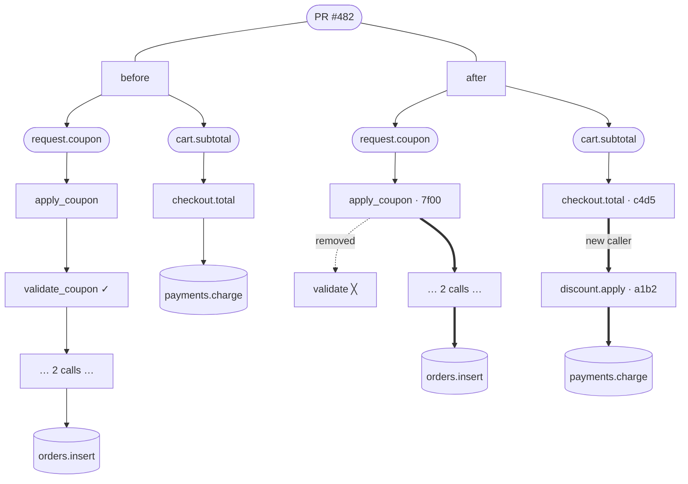
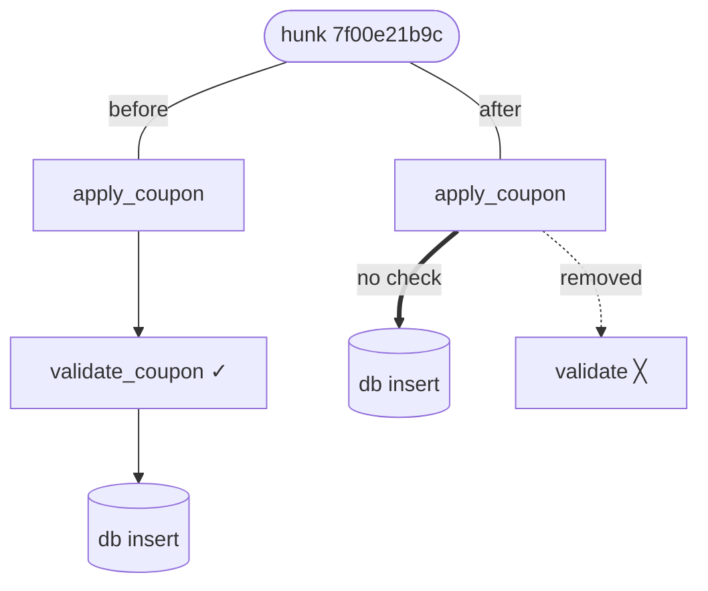
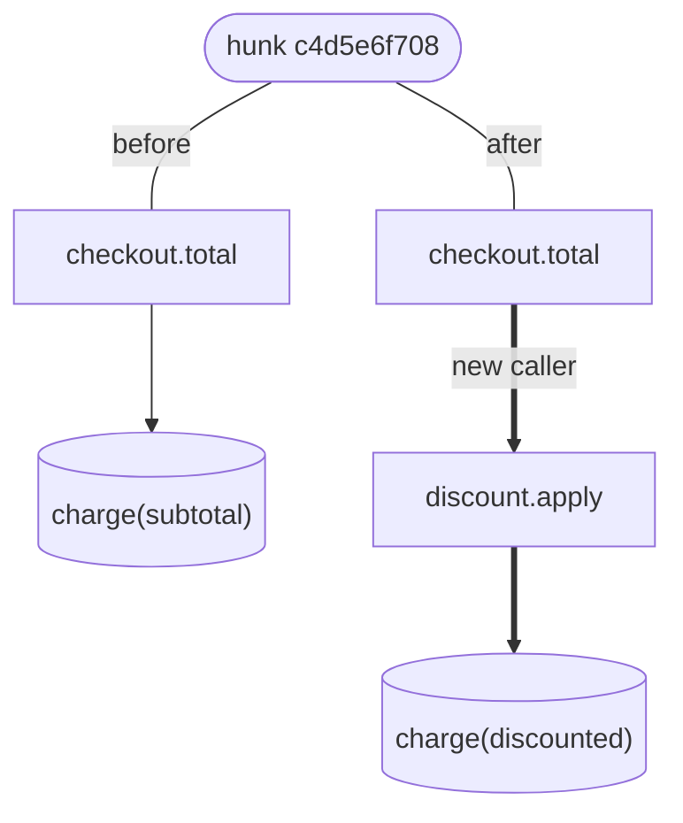
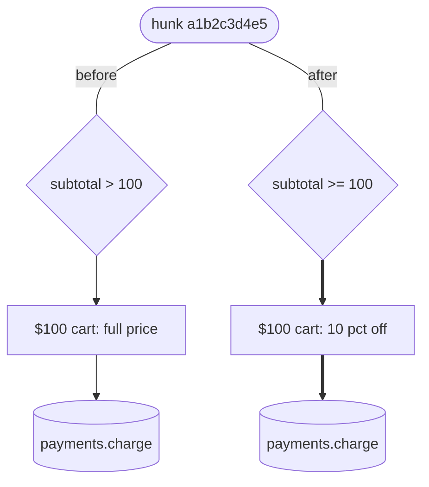

# Witness report · acme/shop#482 "Simplify discount rules"

*Sample output. The PR, code, names and numbers are invented.*

`base 3f2a1c9 → head 9b7e044` · 5 hunks · 3 change data flow · engine: joern (python) · 214 files in scope

---

## Look here first

| | Change | Path | Hunk |
|---|---|---|---|
| **!** | Guard bypassed | `request.coupon` → `db.orders.insert` no longer passes `validate_coupon()` | [`7f00e21b9c`](#7f00e21b9c--coupon-codes-are-no-longer-validated) |
| **~** | Rerouted | `cart.subtotal` → `payments.charge` now goes through `discount.apply()` | [`c4d5e6f708`](#c4d5e6f708--the-discount-moved-into-checkouttotal) |
| **+** | New caller | `checkout.total()` now calls `discount.apply()`, which affects its 4 callers | [`c4d5e6f708`](#c4d5e6f708--the-discount-moved-into-checkouttotal) |

## Description check

- ✗ **Described, not found:** "adds rate limiting to the coupon endpoint". No change in this PR does that.
- ✗ **Found, not described:** coupon validation was removed (hunk `7f00e21b9c`).

## How the data flow changes

Before on the left, after on the right. Only the nodes that matter are shown: changed code, guards, sources, sinks, and places where a path splits. Unchanged calls in between are collapsed to `…`. A dashed edge was removed, a bold edge is new, and `· 7f00` names the hunk that changed a node.



---

## Hunks

Each hunk shows its code, then what that code does to the data flow (before on the left, after on the right), then the explanation. The `F` references point to the evidence behind each claim, listed at the end.

### `7f00e21b9c` · Coupon codes are no longer validated

**!** guard bypassed · `orders/coupon.py:12-19`

```diff
 def apply_coupon(order, code):
-    coupon = validate_coupon(code)
-    if coupon is None:
-        raise InvalidCoupon(code)
-    order.coupon = coupon
+    order.coupon = Coupon(code)
     db.orders.insert(order)
```



`apply_coupon()` no longer calls `validate_coupon()` **[F4]**. Any coupon string from the request, including expired or made-up codes, is now stored on the order **[F5]** and discounted at checkout. The PR description doesn't mention this, so it may be accidental.

<details>
<summary>Path, step by step</summary>

| Step | Before | After |
|---|---|---|
| 1 | `api/orders.py:22` `coupon = req.json["coupon"]` | same |
| 2 | `orders/coupon.py:12` `apply_coupon(order, coupon)` | same |
| 3 | `orders/coupon.py:13` `validate_coupon(coupon)` ✓ | removed ╳ |
| 4 | … 2 calls … | … 2 calls … |
| 5 | `orders/repo.py:58` `db.orders.insert(order)` | same, unvalidated |

Confidence: high (joern data flow).

</details>

### `c4d5e6f708` · The discount moved into `checkout.total()`

**~** rerouted · **+** new caller · `checkout/total.py:30-36`

```diff
 def total(cart):
-    return payments.charge(cart.subtotal)
+    discounted = discount.apply(cart)
+    return payments.charge(discounted)
```



`create_order` no longer applies the discount, and `total()` does instead **[F2]**. All 4 callers of `total()` now work with the discounted amount **[F6]**, including `refunds.issue()`. If refunds should return what was actually charged, that's correct. If they assumed the full subtotal, refunds now come up short.

### `a1b2c3d4e5` · Orders of exactly $100 now get the discount

`orders/discount.py:41-47`

```diff
 def apply(cart):
-    if cart.subtotal > 100:
+    if cart.subtotal >= 100:
         return cart.subtotal * 0.9
     return cart.subtotal
```



The threshold changed from `> 100` to `>= 100` **[F1]**, so a $100 cart now gets 10% off, and `payments.charge()` receives that lower total **[F3]**.

### No flow change

| Hunk | Where | What changed |
|---|---|---|
| `9e8d7c6b5a` | `orders/discount.py:60-72` | the rate lookup moved into a helper, `_rate_for(tier)`. Same inputs, same results. |
| `1122334455` | `orders/coupon.py:40-41` | log message text only |

---

## Evidence

| Id | Fact |
|---|---|
| F1 | `orders/discount.py:42` the comparison changed from `>` to `>=` |
| F2 | `checkout/total.py:31` `total()` calls `discount.apply(cart)` (new call edge) |
| F3 | `discount.apply` return value → `payments.charge` amount (data-flow edge, head) |
| F4 | `apply_coupon` → `validate_coupon` call edge exists in base, is missing in head |
| F5 | `request.coupon` → `db.orders.insert` path in head has no guard node |
| F6 | `checkout.total` has 4 callers in head: `api.create_order`, `api.preview`, `refunds.issue`, `jobs.recalc` |

## Coverage

- 3 neighbouring files were not analysed (scope cap 400 files).
- Explanations: claude-sonnet-5-5. 3 of 3 are grounded in the evidence above.
